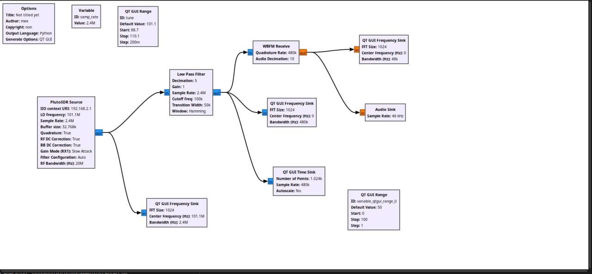
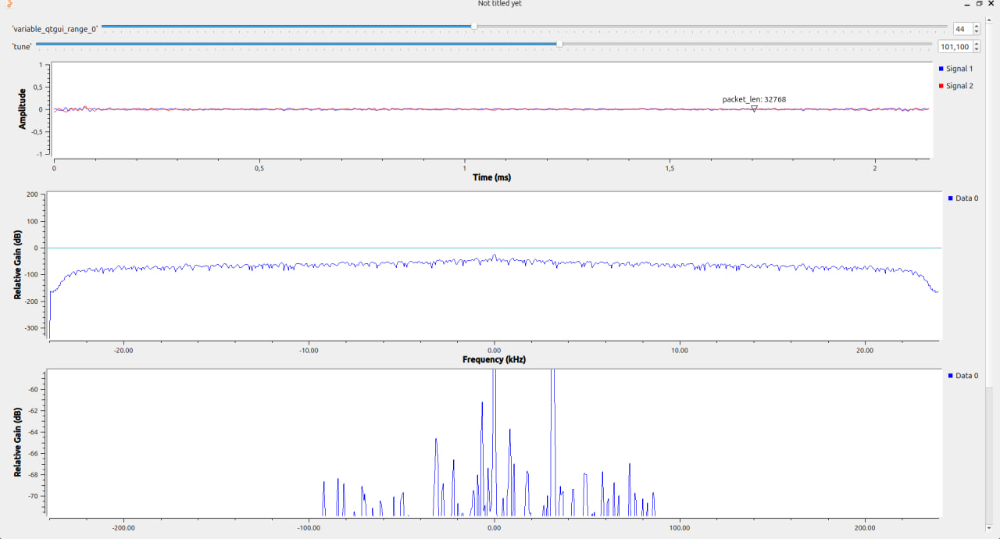

# Недели 1–2. FM-приёмник на ADALM-Pluto

## Что делал

Собрал FM-приёмник в GNU Radio Companion. Подключил Pluto к ноутбуку с Ubuntu и настроил схему на 101,1 МГц.

## Как устроена схема

Сигнал проходит через четыре блока:

**PlutoSDR Source → Low Pass Filter → WBFM Receive → Audio Sink.**

PlutoSDR Source получает отсчёты с устройства. Low Pass Filter оставляет нужную полосу сигнала. WBFM Receive восстанавливает звук из FM-сигнала, а Audio Sink выводит его на динамики.



*Рисунок 1. Схема приёмника в GNU Radio Companion.*

## Основные настройки

- Частота приёма: 101,1 МГц.
- Частота дискретизации Pluto: 2,4 МГц.
- Частота среза фильтра: 100 кГц.
- Децимация фильтра: 5.
- Децимация аудио: 10.

После фильтра частота дискретизации уменьшается до 480 кГц:

```text
2 400 000 / 5 = 480 000 отсчётов/с.
```

После демодулятора получаем 48 кГц для звукового выхода:

```text
480 000 / 10 = 48 000 отсчётов/с.
```

## Что получилось

Схема запустилась. В отдельном окне появились графики и ползунок настройки частоты.



*Рисунок 2. Графики при настройке на 101,1 МГц.*

Верхний график показывает I и Q принятого сигнала. Средний показывает спектр после демодуляции, нижний показывает спектр после фильтра. По ним наблюдал, как выглядит сигнал на разных этапах обработки.

## Итог

Собрал схему FM-приёмника и вывел сигнал на графики. Разобрался, зачем нужны фильтр и демодулятор и как частота дискретизации уменьшается от 2,4 МГц до 48 кГц.