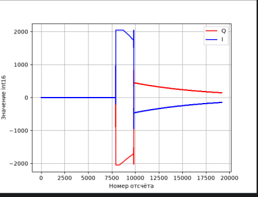

# Неделя 3. Работа с ADALM-Pluto через SoapySDR

## Что делал

Перешёл от работы в GNU Radio Companion к программе на C/C++. Использовал пример из методички для приёма и передачи сигнала через SoapySDR. Полученные отсчёты вывел на график с помощью Python.

## Используемые библиотеки

Для работы с устройством используются четыре библиотеки:

- **libiio** обеспечивает обмен данными с Pluto.
- **libad9361-iio** используется для настройки радиочастотной части.
- **SoapySDR** предоставляет функции управления приёмом и передачей.
- **SoapyPlutoSDR** связывает SoapySDR с устройством ADALM-Pluto.

## Как работает программа

Сначала программа подключается к Pluto и задаёт параметры RX и TX. Затем создаёт потоки приёма и передачи и выделяет память для буферов.

В передающий буфер записываются значения I и Q. Приёмный буфер получает отсчёты с устройства. Каждый комплексный отсчёт содержит два значения int16: сначала I, затем Q.

При чтении программа получает временную метку блока. Она нужна для привязки отсчётов ко времени и проверки интервалов между блоками. В примере передача назначается относительно временной метки принятого блока.

Полученные данные сохраняются в PCM-файл. Скрипт Python читает значения I и Q и строит две линии на одном графике.

## Что получилось

*Рисунок 1. График сигнала. Синим показана I-компонента, красным Q-компонента.*

По горизонтали указан номер отсчёта, по вертикали значение int16.

До участка около 8000-го отсчёта обе линии находятся около нуля. Затем I резко возрастает примерно до 2000, а Q уменьшается примерно до −2000. В области 10 000-го отсчёта виден резкий переход, после которого обе компоненты постепенно приближаются к нулю.

На графике видны начало и окончание выраженного импульсного участка. Временные метки на этом рисунке не представлены, поэтому по нему оценивается форма I и Q.

## Итог

Запустил пример работы с ADALM-Pluto через SoapySDR и построил график полученных отсчётов. Разобрал назначение буферов RX и TX, порядок хранения I и Q и использование временных меток в программе.
