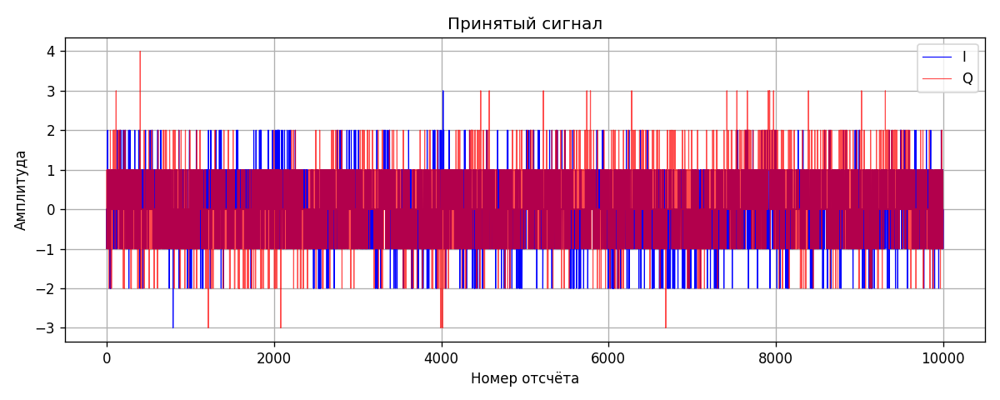

# Неделя 4. Чтение PCM и график I/Q

Отсчёты из SDR записываются в PCM парами: I, Q, I, Q. Каждое значение имеет тип int16. Для чтения использовал NumPy:

```python
iq = np.memmap("rxdata.pcm", dtype="<i2", mode="r").reshape(-1, 2)
I = iq[:, 0]
Q = iq[:, 1]
```

Построил I и Q на одном графике. Ниже участок фона из записи:



Большая часть значений находится около нуля, встречаются небольшие выбросы. Запись при разных усилениях отдельно не сохранилась, поэтому сравнение gain 0 и 40 дБ здесь не делал.

График строится через [plot.py](../plot.py):

```bash
python3 plot.py rxdata.pcm --start 10000000 --count 10000
```

Разобрался с порядком I/Q в файле и построением графика по выбранному участку записи.
