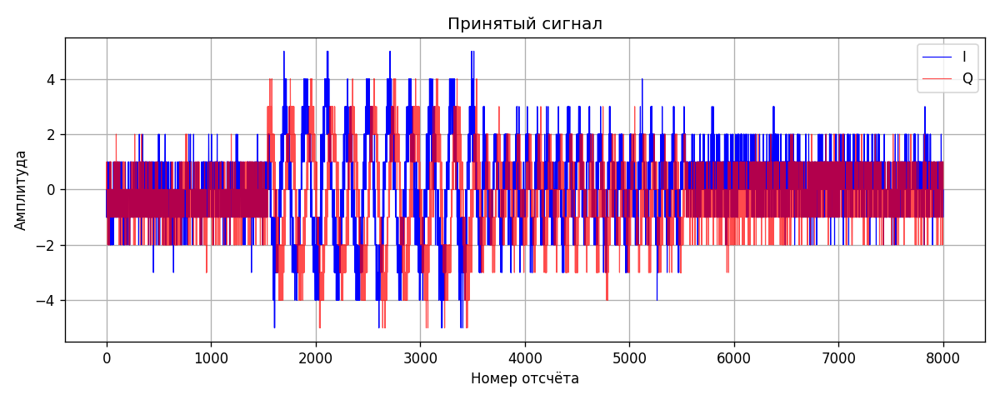
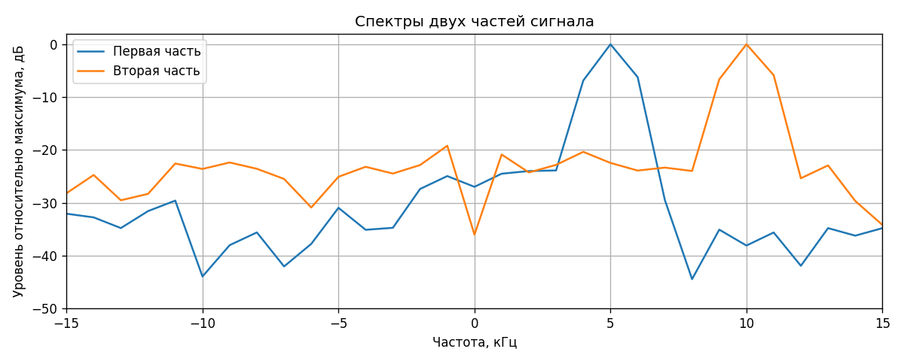

# Неделя 6. Приём двухтонового сигнала

В [двухтоновом передатчике](../experiments/two_tone/main.c) сигнал состоит из трёх частей:

- 2 мс тона 5 кГц;
- 2 мс тона 10 кГц с меньшей амплитудой;
- 300 мс нулей.

Весь цикл занимает 304 мс. Несущая в коде — 800 МГц, частота дискретизации — 1 МГц.

Открыл `rxdata.pcm` и выбрал участок с одним всплеском:

Сигнал слабый, поэтому на фоне шума виден не очень хорошо. В первой части амплитуда больше, во второй — меньше.

Чтобы посмотреть частоты, взял по 1000 отсчётов из каждой части и построил FFT:

Первый пик находится около 5 кГц, второй — около 10 кГц. Каждый спектр показан относительно своего максимума. Частоты рассчитаны при Fs=1 МГц из исходников.

По частотам и периоду запись совпадает с двухтоновым передатчиком. Следующий шаг — повторить приём с разными усилениями, чтобы сигнал лучше выделялся над шумом.

Код графиков: [plot.py](../plot.py) и [spectrum.py](../spectrum.py).
